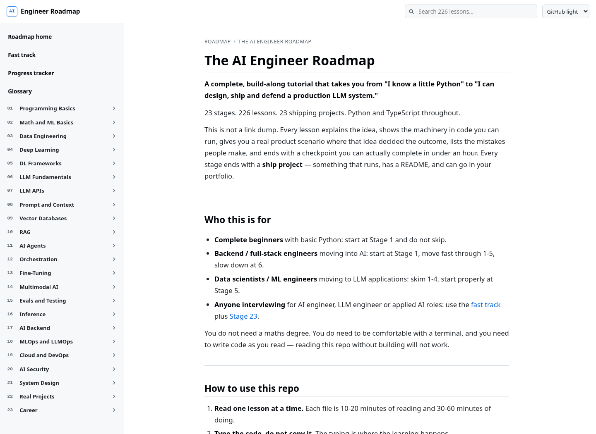
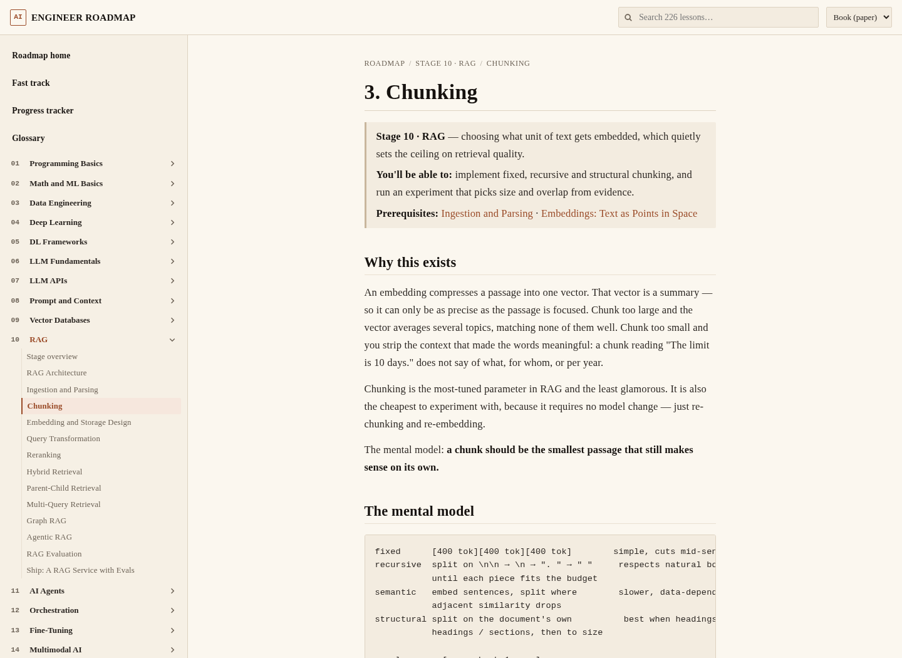
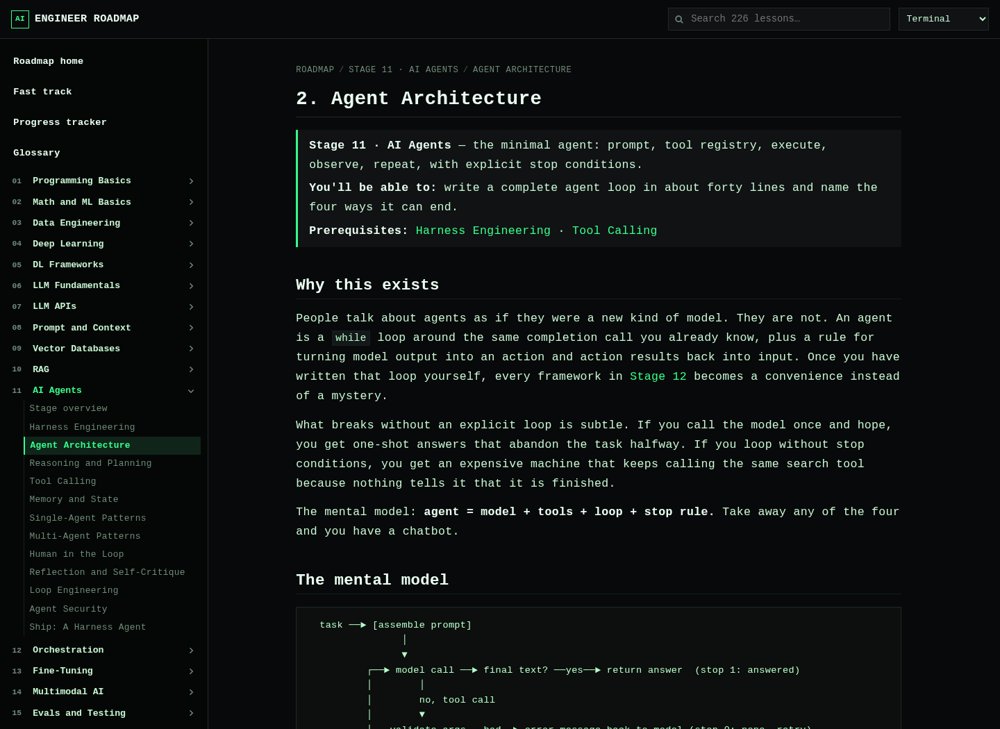

# The AI Engineer Roadmap

**A complete, build-along tutorial that takes you from "I know a little Python" to "I can design, ship and defend a production LLM system."**

23 stages. 228 lessons. 23 shipping projects. Python and TypeScript throughout.

This is not a link dump. Every lesson explains the idea, shows the machinery in code you can run, gives you a real product scenario where that idea decided the outcome, lists the mistakes people make, and ends with a checkpoint you can actually complete in under an hour. Every stage ends with a **ship project** — something that runs, has a README, and can go in your portfolio.

**Read it as a site:** [vkdev01.github.io/ai-engineer-roadmap](https://vkdev01.github.io/ai-engineer-roadmap/) — search, sidebar navigation, and five switchable reading styles.



| Book (paper) | Terminal |
|---|---|
|  |  |

---

## Who this is for

- **Complete beginners** with basic Python: start at Stage 1 and do not skip.
- **Backend / full-stack engineers** moving into AI: start at Stage 1, move fast through 1-5, slow down at 6.
- **Data scientists / ML engineers** moving to LLM applications: skim 1-4, start properly at Stage 5.
- **Anyone interviewing** for AI engineer, LLM engineer or applied AI roles: use the [fast track](#the-fast-track) plus [Stage 23](stages/23-career/README.md).

You do not need a maths degree. You do need to be comfortable with a terminal, and you need to write code as you read — reading this repo without building will not work.

---

## How to use this repo

1. **Read one lesson at a time.** Each file is 10-20 minutes of reading and 30-60 minutes of doing.
2. **Type the code, do not copy it.** The typing is where the learning happens.
3. **Do the checkpoint before moving on.** If you cannot do exercise 1, re-read the file.
4. **Ship the stage project.** It is the difference between "I read about RAG" and "I built a RAG service and measured it."
5. **Tick it off** in [PROGRESS.md](PROGRESS.md). Visible progress is what keeps people going.
6. **When something breaks, that is the curriculum.** Debugging an OOM, a bad retrieval, a looping agent — that is the actual job.

Every lesson follows the same shape, so you always know where you are:

```text
# N. Title
> stage, what you'll be able to do, prerequisites
## Why this exists        — the problem, before this idea existed
## The mental model       — one picture you can hold in your head
## Core concepts          — the mechanism, with small examples
## Code                   — Python, then TypeScript where it applies
## Real use case          — a product scenario, with what broke before
## Common mistakes        — what people get wrong, and what to do instead
## Checkpoint             — three exercises + a self-check
## Go deeper              — what to read or build next
```

---

## The map

| # | Stage | What it gives you |
|---|-------|-------------------|
| 1 | [Programming Basics](stages/01-programming-basics/README.md) | Python you can actually ship: async, types, generators, git, HTTP, JSON |
| 2 | [Math and ML Basics](stages/02-math-and-ml-basics/README.md) | The maths an AI engineer really uses, and nothing else |
| 3 | [Data Engineering](stages/03-data-engineering/README.md) | Clean data, SQL, Parquet/JSONL, validated datasets |
| 4 | [Deep Learning](stages/04-deep-learning/README.md) | From a perceptron to a transformer block you wrote yourself |
| 5 | [DL Frameworks](stages/05-dl-frameworks/README.md) | PyTorch, autograd, training loops, GPUs, Hugging Face |
| 6 | [LLM Fundamentals](stages/06-llm-fundamentals/README.md) | Tokens, context, attention, pretraining, tuning — how an LLM works |
| 7 | [LLM APIs](stages/07-llm-apis/README.md) | Streaming, structured output, tools, retries, cost, routing |
| 8 | [Prompt and Context](stages/08-prompt-and-context/README.md) | Prompts as engineered, versioned, tested artefacts |
| 9 | [Vector Databases](stages/09-vector-databases/README.md) | Embeddings, similarity, indexes, ANN, hybrid search |
| 10 | [RAG](stages/10-rag/README.md) | Retrieval done properly, and measured |
| 11 | [AI Agents](stages/11-agents/README.md) | Harness engineering: the loop, tools, memory, budgets |
| 12 | [Orchestration](stages/12-orchestration/README.md) | LangGraph, LangChain, LlamaIndex, DSPy, Pydantic AI |
| 13 | [Fine-Tuning](stages/13-fine-tuning/README.md) | SFT, LoRA/QLoRA, DPO, and when not to fine-tune |
| 14 | [Multimodal AI](stages/14-multimodal/README.md) | Vision, OCR, speech, video, diffusion, multimodal RAG |
| 15 | [Evals and Testing](stages/15-evals/README.md) | The skill that separates production from demos |
| 16 | [Inference](stages/16-inference/README.md) | KV cache, batching, quantization, vLLM, GPU maths |
| 17 | [AI Backend](stages/17-ai-backend/README.md) | FastAPI, streaming, queues, caching, auth, quotas |
| 18 | [MLOps and LLMOps](stages/18-mlops-llmops/README.md) | Tracing, prompt registries, cost monitoring, eval CI |
| 19 | [Cloud and DevOps](stages/19-cloud-devops/README.md) | Docker, Kubernetes, GitHub Actions, Terraform, GPU cloud |
| 20 | [AI Security](stages/20-ai-security/README.md) | Injection, leakage, PII, sandboxing, guardrails |
| 21 | [System Design](stages/21-system-design/README.md) | Designing and defending an AI system end to end |
| 22 | [Real Projects](stages/22-real-projects/README.md) | Thirteen build briefs for portfolio-grade projects |
| 23 | [Career](stages/23-career/README.md) | Portfolio, resume, interviews, open source, applying |

### The original 23-step tree

The repo you are reading is this tree, expanded into full lessons:

```text
ai-engineer-roadmap
┃
┣ Start Here (fast track)
┃ ┣ 7-llm-apis    ┣ 8-prompt-and-context   ┣ 10-rag
┃ ┣ 11-agents     ┣ 12-loops-and-graphs     ┣ 15-evals
┃ ┗ 22-one-real-project
┃
┣ 1. Programming Basics      python-async · type-hints-pydantic · generators ·
┃                            algorithms · git-github · linux-cli · http-rest-apis ·
┃                            json-yaml · ship-cli-tool
┣ 2. Math and ML Basics      linear-algebra · calculus · probability-bayes ·
┃                            ml-basics · loss-functions · backprop-gradients ·
┃                            ship-gradient-descent
┣ 3. Data Engineering        numpy-pandas · data-cleaning · eda · sql-postgresql ·
┃                            parquet-jsonl · data-pipelines · validation ·
┃                            dataset-prep · ship-clean-dataset
┣ 4. Deep Learning           perceptrons · feedforward · optimizers · cnns-rnns ·
┃                            lstms-grus · attention · transformers · embeddings ·
┃                            transfer-learning · ship-mini-transformer
┣ 5. DL Frameworks           pytorch · autograd · training-loops · gpu-checkpoints ·
┃                            keras · hugging-face · cuda · ship-training-loop
┣ 6. LLM Fundamentals        gpt-and-bert · tokenization · context-windows ·
┃                            self-attention · pretraining · instruction-tuning ·
┃                            rlhf-dpo · open-vs-closed · ship-tokenizer
┣ 7. LLM APIs                openai-anthropic · gemini-open-weight · streaming ·
┃                            structured-outputs · tool-calling · multimodal-apis ·
┃                            retries-rate-limits · cost-tracking · routing-fallbacks ·
┃                            ship-multi-model-client
┣ 8. Prompt and Context      system-instructions · few-shot-cot · templates ·
┃                            context-compression · prompt-versioning ·
┃                            injection-defense · prompt-evals · context-engineering ·
┃                            ship-prompt-test-suite
┣ 9. Vector Databases        embeddings · similarity-metrics · semantic-search ·
┃                            vector-indexing · ann-search · pinecone-qdrant ·
┃                            weaviate-milvus · chroma · hybrid-search ·
┃                            ship-semantic-search
┣ 10. RAG                    rag-architecture · ingestion-parsing · chunking ·
┃                            embedding-storage · query-transform · reranking ·
┃                            hybrid-retrieval · parent-child · multi-query ·
┃                            graph-rag · agentic-rag · rag-evals ·
┃                            ship-rag-with-evals
┣ 11. AI Agents              harness-engineering · agent-architecture ·
┃                            reasoning-planning · tool-calling · memory-and-state ·
┃                            single-agent · multi-agent · human-in-the-loop ·
┃                            reflection · loop-engineering · agent-security ·
┃                            ship-harness-agent · seven-harness-skills
┣ 12. Orchestration          langchain · langgraph · graph-engineering · llamaindex ·
┃                            haystack · semantic-kernel · pydantic-ai · dspy ·
┃                            crewai-autogen · tradeoffs · ship-langgraph-flow
┣ 13. Fine-Tuning            sft · lora-qlora-peft · synthetic-data ·
┃                            instruction-tuning · dpo · finetune-evals ·
┃                            finetune-vs-rag · ship-lora-model ·
┃                            finetune-by-outcome
┣ 14. Multimodal AI          vision-language · ocr · speech-to-text · text-to-speech ·
┃                            video-audio · multimodal-embeddings · diffusion ·
┃                            multimodal-rag · ship-doc-reader
┣ 15. Evals and Testing      unit-tests · llm-as-judge · golden-datasets ·
┃                            faithfulness · hallucinations · agent-evals ·
┃                            human-evals · regression-tests · online-offline-evals ·
┃                            ship-eval-suite
┣ 16. Inference              prefill-decode · kv-cache · continuous-batching ·
┃                            pagedattention · speculative-decoding · quantization ·
┃                            distillation · vllm-sglang · ollama-tensorrt ·
┃                            gpu-memory · ship-vllm-server
┣ 17. AI Backend             fastapi-flask · websockets · async-processing ·
┃                            redis-caching · job-queues · auth-rate-limits ·
┃                            api-security · ai-app-architecture ·
┃                            ship-streaming-api
┣ 18. MLOps and LLMOps       mlflow-wandb · langfuse-langsmith · prompt-versioning ·
┃                            dvc · tracing · cost-monitoring · ci-cd-evals ·
┃                            ship-trace-dashboard
┣ 19. Cloud and DevOps       aws-s3-ec2-lambda · ecs-eks-sagemaker · gcp-azure-ai ·
┃                            docker · kubernetes · github-actions · terraform ·
┃                            gpu-cloud · ship-docker-deploy
┣ 20. AI Security            prompt-injection · jailbreaks · data-leakage ·
┃                            pii-redaction · sandboxing · supply-chain ·
┃                            bias-fairness · governance · guardrails ·
┃                            ship-injection-tests
┣ 21. System Design          scalable-ai-apps · rag-design · agent-design ·
┃                            model-routing · multi-tenant · caching ·
┃                            fault-tolerance · cost-latency · scaling-tradeoffs ·
┃                            ship-design-doc
┣ 22. Real Projects          research-assistant · document-intelligence ·
┃                            production-rag · multi-agent-research · support-agent ·
┃                            coding-assistant · multimodal-assistant ·
┃                            meeting-intelligence · knowledge-assistant ·
┃                            workflow-automation · fine-tuning-pipeline ·
┃                            eval-platform · ai-saas
┗ 23. Career                 github-portfolio · resume · python-sql-interviews ·
                             ml-llm-basics · system-design-practice ·
                             rag-agent-patterns · inference-optimization ·
                             production-case-studies · open-source ·
                             technical-articles · build-in-public ·
                             apply-for-roles
```

> build the harness, close the loop, wire the graph, then the raise follows

---

## The fast track

If you have three weeks and one goal — get hired, or get a working AI feature into your product — read these seven stages in this order and skip everything else:

**7 → 8 → 10 → 11 → 12 → 15 → 22**

That is: call the APIs properly, engineer the context, retrieve the right documents, build an agent loop, orchestrate it as a graph, prove it works with evals, then build one real project end to end. The full plan, with what to skip and why, is in [FAST-TRACK.md](FAST-TRACK.md).

The rest of the roadmap is not optional for mastery — it is what stops the fast track from producing someone who can only assemble frameworks. You will hit the limits of the fast track at exactly the point where Stage 16 (inference), Stage 17 (backend) or Stage 21 (system design) has the answer.

---

## The 23 shipping projects

Each stage ends with one. Together they are a portfolio that proves range rather than a list of tutorials you followed.

| Stage | You build |
|-------|-----------|
| 1 | A CLI tool with typed config, async I/O and a JSON output contract |
| 2 | Gradient descent from scratch, no frameworks, with training curves |
| 3 | A clean, validated, documented dataset with a data card |
| 4 | A miniature transformer you wrote, trained on a toy task |
| 5 | A reusable training loop with checkpoint resume and metric logging |
| 6 | A tokenizer you implemented, plus a token-budget analyser |
| 7 | A multi-model client with retries, cost ledger and fallback |
| 8 | A prompt test suite with fixtures, assertions and a CI gate |
| 9 | A semantic search service with measured recall |
| 10 | A RAG service with an eval harness and a baseline score |
| 11 | A harness agent with a typed tool registry and step budget |
| 12 | A LangGraph flow with state, routing, persistence and approval |
| 13 | A LoRA fine-tune with a model card and before/after eval |
| 14 | A document reader: scanned PDF → structured JSON with citations |
| 15 | An eval suite with datasets, graders, thresholds and a report |
| 16 | A vLLM server with a load test reporting TTFT and throughput |
| 17 | A streaming chat API with auth, quotas, caching and jobs |
| 18 | A trace dashboard showing latency, cost and eval score |
| 19 | A Dockerised service deployed by CI, with a rollback path |
| 20 | An injection test suite that fails CI on regression |
| 21 | A full design document with capacity and cost arithmetic |
| 22 | One complete product-grade project from thirteen briefs |
| 23 | A portfolio, a resume and a story for each project |

---

## Repo conventions

- `stages/NN-stage-name/` — one folder per stage, one file per topic, numbered in reading order.
- Every stage folder has a `README.md` index with the topic table and completion criteria.
- Links are relative, so the repo works offline in any markdown viewer and on GitHub.
- Code is illustrative but honest: it runs, or it is clearly marked as a sketch. Provider SDKs, model ids and prices change — lessons say so where it matters, and you should check the current docs before you paste a model id into production.
- `code/` holds shared scaffolding (`requirements.txt`, `package.json`, env template) that the lessons assume.

## Ground rules that make this work

1. **One idea per file.** If you feel lost, you skipped a prerequisite — the file header tells you which.
2. **Evals before features.** From Stage 15 onward, nothing is "done" without a number that proves it.
3. **Write it down.** Every project gets a README with the problem, the design decision, the measurement and the lesson. That document is what you will talk about in interviews.
4. **Cost is a design constraint, not an afterthought.** Every stage that touches an API asks what it costs per thousand requests.
5. **The model is the least reliable component.** Assume it fails, loops, hallucinates and gets injected, then design so that failure is survivable.

---

[Start at Stage 1 →](stages/01-programming-basics/README.md) · [Fast track](FAST-TRACK.md) · [Progress](PROGRESS.md) · [Glossary](GLOSSARY.md) · [Contributing](CONTRIBUTING.md)

MIT licensed. Built to be forked, annotated and argued with.
